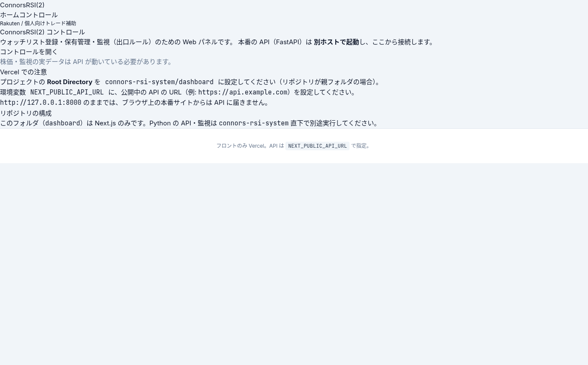

# ConnorsRSI(2) Monitor (rakuten)

ConnorsRSI(2)戦略のルールに沿って、ウォッチ銘柄と保有ポジションを監視する個人用ツール / A personal tool that monitors a watchlist and positions against ConnorsRSI(2) rules

**Dashboard (frontend only):** https://rakuten-alpha.vercel.app



> ⚠️ 学習目的の個人プロジェクトです。投資助言ではありません。運用成績についての主張は一切しません。
> This is a personal learning project, not investment advice. No performance claims are made.

---

## 日本語

### 構成
- **Python バックエンド**（`connors-rsi-system/`）
  - `main.py screen` : 候補銘柄のスクリーニング／手動ウォッチ登録（TradingViewスクリーナーの取得はPlaywright）
  - `main.py monitor` : 株価を定期取得し、損切り・利確・高値からのトレール・保有日数上限などの出口ルールを評価（`--demo` あり）
  - `main.py analyze` / `report` : クローズ済みトレードの集計とHTML週次レポート
  - `main.py api` : ダッシュボード用のREST API（FastAPI）
  - 株価ソース: yfinance（遅延データ）または楽天証券MarketSpeedが書き出したExcelファイル
  - 通知: LINE Notify / Slack Webhook（任意、設定時のみ）
  - データ: SQLite（`data/watchlist.db`、リポジトリには含まれません）
- **Next.js ダッシュボード**（`connors-rsi-system/dashboard/`）
  - ウォッチリスト登録・保有管理・監視の開始/停止を行うWebパネル。APIは別ホストで起動して接続します（Vercel上のページ単体ではデータは表示されません）。

### 注意点
- 注文は実際には発注しません。`order_manager` はログとDB更新のみ（ペーパー相当）です。
- 設定値（`config.yaml`）は戦略ルールの例であり、検証済みのパラメータではありません。

**技術スタック:** Python（pandas, FastAPI, APScheduler, yfinance, Playwright）/ Next.js 14 + React 18 + Tailwind CSS

### ローカルで動かす
```bash
cd connors-rsi-system
pip install -r requirements.txt
python main.py api            # http://127.0.0.1:8000
python main.py monitor --demo # デモ監視

cd dashboard
cp .env.example .env.local    # NEXT_PUBLIC_API_URL=http://127.0.0.1:8000
npm install && npm run dev
```

---

## English

### Overview
- **Python backend** (`connors-rsi-system/`)
  - `screen`: screen candidates / add symbols to the watchlist manually (TradingView screener fetched via Playwright)
  - `monitor`: poll prices and evaluate exit rules (stop loss, profit target, trailing stop from peak, max holding days); `--demo` mode available
  - `analyze` / `report`: summarize closed trades and generate a weekly HTML report
  - `api`: FastAPI REST API for the dashboard
  - Price source: yfinance (delayed) or an Excel file exported from Rakuten MarketSpeed
  - Optional LINE Notify / Slack webhook alerts
  - Storage: SQLite (`data/watchlist.db`, not committed)
- **Next.js dashboard** (`connors-rsi-system/dashboard/`): a web panel for the watchlist, positions and starting/stopping the monitor. It talks to the API running on a separate host; the Vercel page alone shows no data.

### Notes
- No real orders are placed; `order_manager` only logs and updates the database (paper-style).
- Values in `config.yaml` are example strategy rules, not validated parameters.

**Tech stack:** Python (pandas, FastAPI, APScheduler, yfinance, Playwright) / Next.js 14, React 18, Tailwind CSS

### Run locally
See the commands above.
